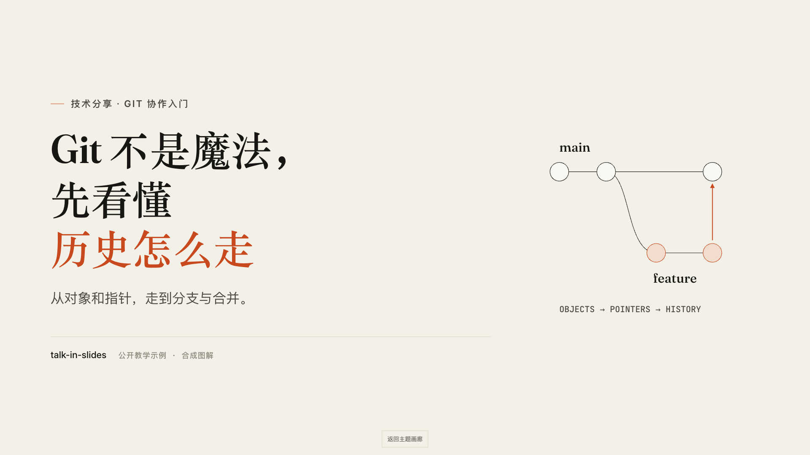
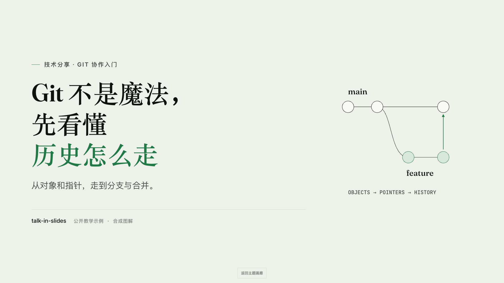
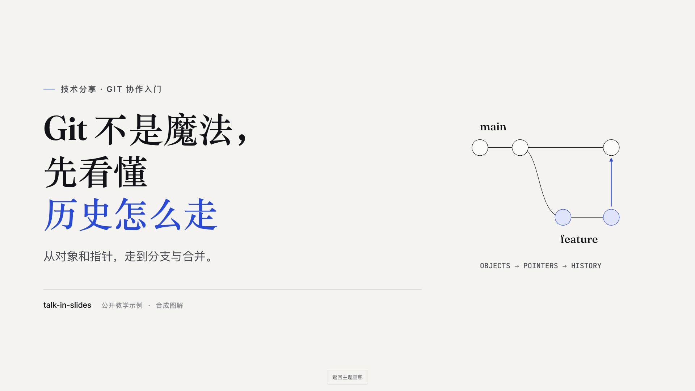
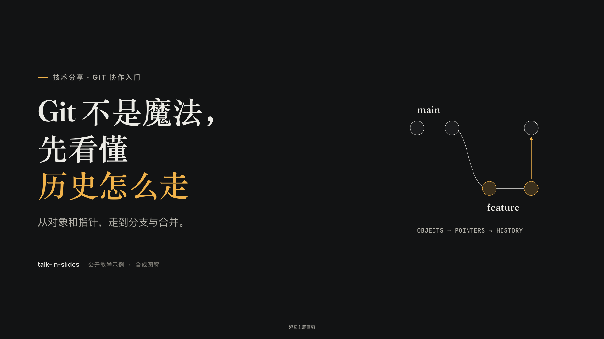
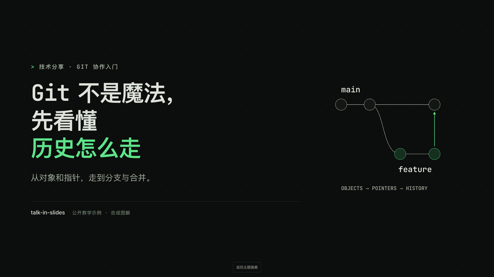
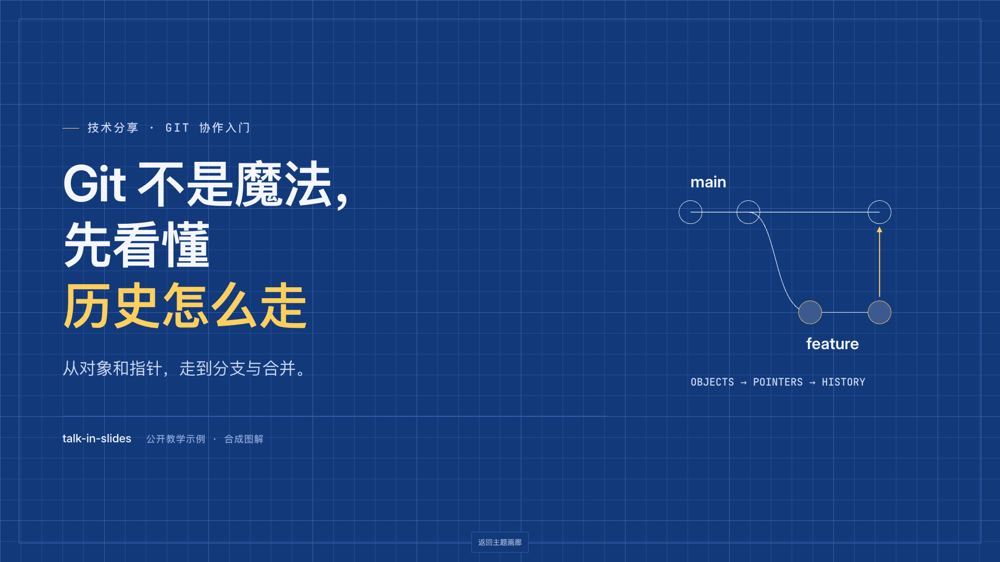
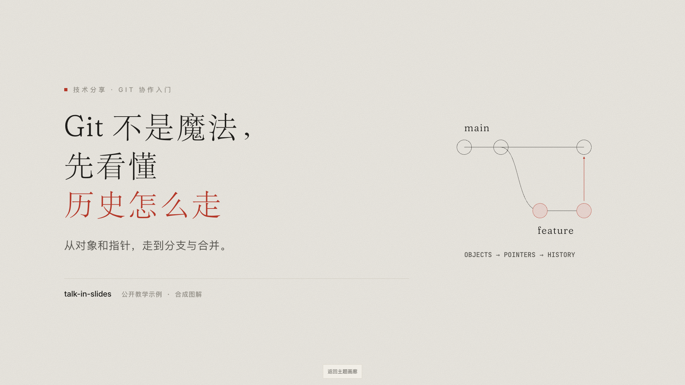

# talk-in-slides-skill

**把技术分享、讲座和课程，做成可以发链接的网页演示。**

技能名称为 `talk-in-slides`。这是一个面向 AI 编程助手的技能，也是一套可以直接编辑的静态 HTML 演示框架。先写逐页提纲，再搭页面、编排点击节奏，最后用真实浏览器截图检查。所有页面排在一张画布上，翻页时镜头移动；一页内可以分步揭示、突出重点、推近细节。



## 先看实际效果

打开仓库根目录的 [index.html](index.html)，进入七主题画廊。每套示例都是同一份「Git 不是魔法」：8 页、相同图解、相同点击节奏，只有风格不同。

| 暖纸                                                                  | 灰绿                                                                    |
| --------------------------------------------------------------------- | ----------------------------------------------------------------------- |
| [](example/paper/index.html)       | [](example/sage/index.html)           |
| 冷白                                                                  | 夜场                                                                    |
| [](example/cobalt/index.html)     | [](example/night/index.html)         |
| 终端                                                                  | 蓝图                                                                    |
| [](example/terminal/index.html) | [](example/blueprint/index.html) |
| 余白                                                                  |                                                                         |
| [](example/yohaku/index.html)     |                                                                         |

GitHub 的文件页面展示 HTML 源码；这里的截图可直接预览。完整的镜头运动、分步和总览需要本地打开，或通过 GitHub Pages 访问。

## 安装为技能

下载或克隆仓库后，在仓库根目录执行以下命令。以 macOS / Linux 的符号链接为例，目标目录已存在时命令会失败，先确认现有安装的用途。

```bash
mkdir -p "$HOME/.agents/skills"
ln -s "$PWD" "$HOME/.agents/skills/talk-in-slides"
```

如果使用的助手只从自己的技能目录发现技能，可将链接放到对应目录。例如 Claude Code 使用 `$HOME/.claude/skills/talk-in-slides`，Codex 可使用 `$HOME/.codex/skills/talk-in-slides`。Windows 可把整个仓库复制到对应技能目录。保持 `SKILL.md`、`template/`、`references/` 和 `tools/` 的相对位置。

然后告诉助手：

> 用 talk-in-slides 做一份 10 分钟的 Git 分享，面向刚入职的工程师，中文，使用终端风格。先给逐页提纲，再生成页面并检查。

## 直接编辑一份演示

复制模板到新目录，修改 `index.html`，按需修改 `css/custom.css`：

```bash
cp -R template my-talk
```

不需要运行构建工具。用浏览器打开 `my-talk/index.html` 即可；如需演讲者窗口，建议通过本地 HTTP 服务打开，并允许弹窗：

```bash
python3 -m http.server 8000
```

进入 `http://localhost:8000/my-talk/`。模板自带本地字体和 reveal.js，浏览演示不需要 CDN、登录或 API 密钥。

- ← / → / 空格：后退、前进、逐步揭示。
- M：总览；方向键或数字选页，Enter 进入，Esc 返回。
- S：演讲者视图；F：全屏；B：暂停。
- 触屏：轻点右侧前进、左侧后退，横向滑动翻页。画布为 16:9，手机横屏观看更清晰。

## 选一种风格

| 风格 | 根元素属性                                 | 适合场景               |
| ---- | ------------------------------------------ | ---------------------- |
| 暖纸 | `data-theme="paper"`                       | 讲座、分享、课程       |
| 灰绿 | `data-theme="sage"`                        | 研究、复盘、阅读       |
| 冷白 | `data-theme="cobalt"`                      | 产品、方案、商务汇报   |
| 夜场 | `data-theme="night"`                       | 大会、发布、暗场       |
| 终端 | `data-skin="terminal" data-theme="night"`  | 工程、开源、故障复盘   |
| 蓝图 | `data-skin="blueprint" data-theme="night"` | 架构、系统、路线图     |
| 余白 | `data-skin="yohaku" data-theme="paper"`    | 中文讲稿、方法论、设计 |

终端和蓝图也支持浅色 `paper`，余白支持深色 `night`。中文字体使用系统回退，跨操作系统的字形可能不同；对外分享前应在目标环境检查排版。

## 检查与导出

开发检查需要 Node.js 22 或更新版本，以及 Google Chrome / Microsoft Edge。也可用 `CHROME_PATH` 指定 Chromium 可执行文件。浏览器只用于检查，不是观看依赖。

```bash
npm ci --prefix tools
npm run check
npm test
npm run test:browser
node tools/shoot.mjs my-talk
node tools/shoot.mjs my-talk --all-steps
node tools/shoot.mjs my-talk --pdf --scale 2
```

`shoot.mjs` 检查版面边界、行数、重叠、裁切、字号、资源错误，并输出逐页截图、总览图和报告。检查失败时返回非零退出码。PDF 导出为每页最终态的截图，适合保留版面，不包含可搜索的文字或动画。

截图、PDF 和检查报告默认写入演示的 `shots/`，不会自动提交。报告可能含本机路径，不应作为公开素材上传。版面检查不能替代人工看图与真机动效验收。

## 维护同题示例

只编辑 [示例内容源](example/_source/index.html)、[共用样式](example/git.css) 和 [逐页提纲](example/outline.md)，然后执行：

```bash
npm run examples
npm run screenshots
npm run check
npm test
npm run test:browser
```

生成器仅更换主题属性，避免七份讲稿漂移。真实封面截图写入 `example/previews/`；完整终态、逐步截图和原始报告保留在本地 `.artifacts/`。根画廊由 `scripts/build-examples.mjs` 生成。

## 发布到 GitHub Pages

先创建自己的仓库并推送。在 **Settings → Pages → Build and deployment → Source** 选择 **GitHub Actions**，再手动运行仓库中的 **Deploy examples** 工作流。此工作流只由手动操作触发，修改主分支不会自动发布。

工作流会执行 `npm run site`，把画廊、七套示例和运行所需静态资源复制到 `_site/`，再部署到 Pages。不会把检查报告、代理文档、依赖目录或本地配置上传到站点。部署成功后，GitHub Actions 会给出真实访问地址，可以放进仓库的 About / Website 字段。

本地可先运行 `npm run site`，再在 `_site/` 下启动静态服务检查。当前仓库不预设用户名、远端地址或自定义域名。

配置方式见 [GitHub Pages 官方说明](https://docs.github.com/en/pages/getting-started-with-github-pages/configuring-a-publishing-source-for-your-github-pages-site)。

## 结构

```text
SKILL.md             给 AI 助手的创作流程与质量规则
references/          版式、图解、动效和评审指南
template/            可复制的完整演示模板
example/             同题内容源、七主题成品和真实预览图
scripts/             示例生成、检查与站点打包
tools/               截图、版面 lint、PDF 和测试
index.html           主题画廊
```

## 许可与参考

原创部分使用 [MIT License](LICENSE)。reveal.js 和本地字体各自保留许可与署名，详见 [第三方组件与设计参考](THIRD_PARTY_NOTICES.md)。
